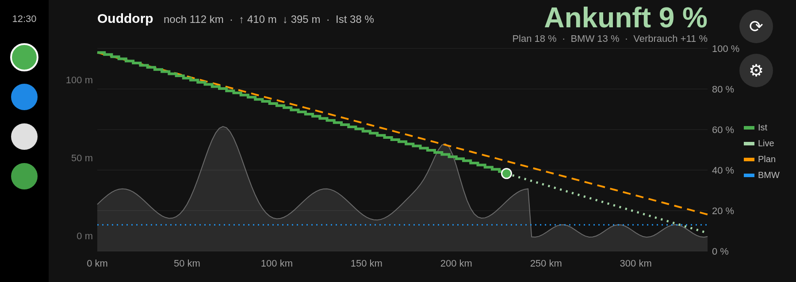

# i4 Energie

An Android Auto app that shows **remaining battery over distance** for your EV while you drive, fed by [Home Assistant](https://www.home-assistant.io/). Built for and tested in a BMW i4 eDrive40, but the app itself only reads Home Assistant sensors, so it works with any car you can get the data for.



*Mockup with sample data. Real rendering on the car display looks the same.*

## What you see

| Element | Meaning |
|---|---|
| **Green steps** | Actual state of charge (SOC) recorded during this trip |
| **Orange dashed** | Planned SOC along the route (forecast computed in Home Assistant) |
| **Light green dotted** | Live forecast: the plan, corrected by how your actual consumption compares to it so far |
| **Blue dotted** | BMW's own arrival SOC (only while the BMW navigation is active) |
| **Grey area** | Elevation profile of the route |
| **Header** | Destination, remaining km, ascent/descent, current SOC, predicted arrival SOC, plan vs. BMW vs. consumption deviation |

The display stays visible **while driving**: the app registers as a navigation app, a category Android Auto allows to draw its own surface. It never starts turn-by-turn guidance, so it does not compete with Google Maps or the car's built-in navigation.

## How it works

```
Home Assistant (your sensors)  ──REST, every 30 s──▶  Phone app  ──Android Auto──▶  Car display
```

- The app polls the Home Assistant REST API (`/api/states/...`) every 30 s while the car screen is active, plus on start and on the refresh button.
- If the connection drops (tunnel, dead zone), the last data stays visible with a "Stand hh:mm" (last update) hint.
- Home Assistant URL and a long-lived access token are entered in the phone app and stored encrypted on the device. Nothing is sent anywhere else.
- All car-specific logic (trip tracking, route, elevation, forecast) lives in Home Assistant. The app only does the live correction ([ForecastCalc.kt](app/src/main/java/de/i4energie/calc/ForecastCalc.kt), unit-tested) and the drawing.

## Requirements

- An Android phone with Android Auto (Android 10+).
- Home Assistant reachable from the phone's mobile network (e.g. Nabu Casa or your own HTTPS endpoint).
- These Home Assistant entities. See [`homeassistant/`](homeassistant/) for the configuration that creates them.

| Entity | Used fields |
|---|---|
| `sensor.i4_fahrt` (trip) | `attributes.start_km`, `start_soc`, `punkte` = `[[km_since_start, soc], …]`, `fahrtverbrauch` |
| `sensor.i4_route` | `state` = route length km, `attributes.ziel` (destination), `aufstieg`/`abstieg` (ascent/descent m), `start_km`, `profil` = `[[km, elevation_m, lat, lon], …]`, `prognose` = `[soc, …]` (same length as `profil`) |
| `sensor.i4_edrive40_battery_hv_state_of_charge` | current SOC % |
| `sensor.i4_edrive40_trip_battery_charge_level_at_end_of_trip` | BMW arrival SOC % (optional) |

The parser is defensive: missing attributes, `null`, `"unknown"`, `"unavailable"` and numbers as strings are all tolerated.

## ⚠️ Installing it in a real car: Google Play is required

This is the most important lesson from testing:

> **In a real car, Android Auto only shows apps installed through Google Play.**
> "Unknown sources" in Android Auto's developer settings only works with the Desktop Head Unit (DHU) emulator, not with a real car.

What was tried in a BMW i4 (head unit MGU22, wireless Android Auto, Android Auto 17.8, Oct 2026):

| Method | Result |
|---|---|
| Sideload APK via adb + "Unknown sources" on | ❌ Rejected (`CAR.VALIDATOR: Package DENIED; failed all other checks`). The app may launch once as the last-used navigation app, then disappears from the launcher. |
| `adb install -i com.android.vending` (fake Play Store as installer) | ❌ Rejected. Android Auto asks Google Play who owns the app (`PlayGearheadService …, app owners empty`). |
| **Google Play internal testing track** | ✅ Works, stays in the launcher. |

So to run it in your car you need to publish **your own build** to an internal test track in your own Google Play Console (one-time 25 USD developer fee; internal tests are private and not reviewed). Step-by-step guide: [docs/play-internal-testing.md](docs/play-internal-testing.md).

## Building

Requirements: JDK 17 and the Android SDK (or just Android Studio).

```bash
./gradlew testDebugUnitTest assembleDebug     # debug APK for the DHU emulator
./gradlew bundleRelease                       # app bundle for Google Play
```

On Windows use `gradlew.bat`. The GitHub Actions workflow [build.yml](.github/workflows/build.yml) runs the tests and builds APKs on every push.

**Before uploading to Google Play, change the package name.** `de.i4energie` is already taken by my own Play listing. Set your own `applicationId` (and ideally `namespace`) in [app/build.gradle.kts](app/build.gradle.kts).

Release signing: `bundleRelease` looks for `~/.i4energie-signing/keystore.properties`:

```properties
storeFile=/path/to/upload.jks
storePassword=...
keyAlias=upload
keyPassword=...
```

Create a key with `keytool -genkeypair -keystore upload.jks -alias upload -keyalg RSA -keysize 4096 -validity 10000`. Without that file, release builds are signed with the debug key (fine for CI, not accepted by Play).

Build variants:

- **release**: package `de.i4energie`, for Google Play.
- **debug**: package `de.i4energie.debug`, label "i4 Energie Debug", for the DHU. Can be installed next to the Play version.

## Testing with the Desktop Head Unit (DHU)

1. Install the SDK package `extras;google;auto`.
2. On the phone: Android Auto settings → tap "Version" 10× → ⋮ → Developer settings → enable **Unknown sources**. Then ⋮ → **Start head unit server**.
3. `adb forward tcp:5277 tcp:5277`, then start `desktop-head-unit.exe` from `<sdk>/extras/google/auto/`, in an interactive terminal (it exits immediately when its stdin is closed).

Pitfalls learned the hard way:

- Reinstalling the app while the DHU is connected leaves Android Auto with a surface still bound to the dead process (`lockCanvas` → `IllegalArgumentException`). Restart the DHU session.
- Killing the DHU can leave Android Auto in an "Already connected" state. Force-stop Android Auto and start the head unit server again.

## Project structure

| File | Purpose |
|---|---|
| [ForecastCalc.kt](app/src/main/java/de/i4energie/calc/ForecastCalc.kt) | Route/trip offset, plan line, live forecast, arrival, consumption deviation. Pure Kotlin, unit-tested. |
| [HaParser.kt](app/src/main/java/de/i4energie/data/HaParser.kt) | Defensive parsing of Home Assistant state JSON |
| [HaRepository.kt](app/src/main/java/de/i4energie/data/HaRepository.kt) | Polling, keeps the last good state on errors |
| [EnergyScreen.kt](app/src/main/java/de/i4energie/car/EnergyScreen.kt) | `NavigationTemplate` with action strip, surface callback |
| [ChartRenderer.kt](app/src/main/java/de/i4energie/car/ChartRenderer.kt) | Draws header, chart, legend and empty states on the car surface |
| [EnergyCarAppService.kt](app/src/main/java/de/i4energie/car/EnergyCarAppService.kt) | Android Auto entry point, host validation |
| [MainActivity.kt](app/src/main/java/de/i4energie/MainActivity.kt) | Phone settings: URL, token, connection test |
| [SPEC-v1.md](SPEC-v1.md) | Original specification (German) |

Stack: Kotlin, `androidx.car.app` 1.7.0, AGP 8.13, minSdk 29, targetSdk 36. The UI is German.

## Disclaimer

Hobby project, not affiliated with or endorsed by BMW AG or Google. "BMW" and "i4" are trademarks of BMW AG. Do not interact with the app while driving; it is designed to be glanced at, like a navigation display.

## License

[MIT](LICENSE)
